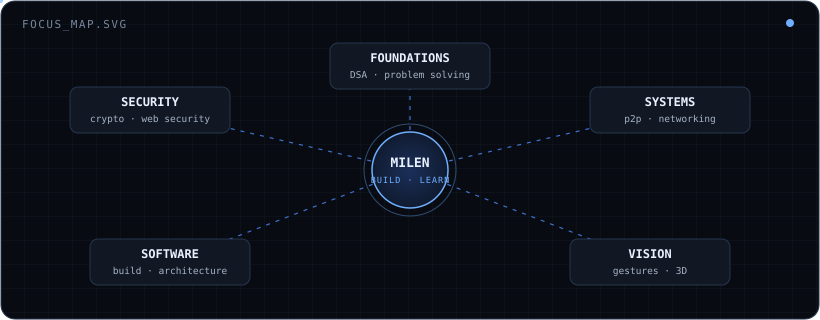
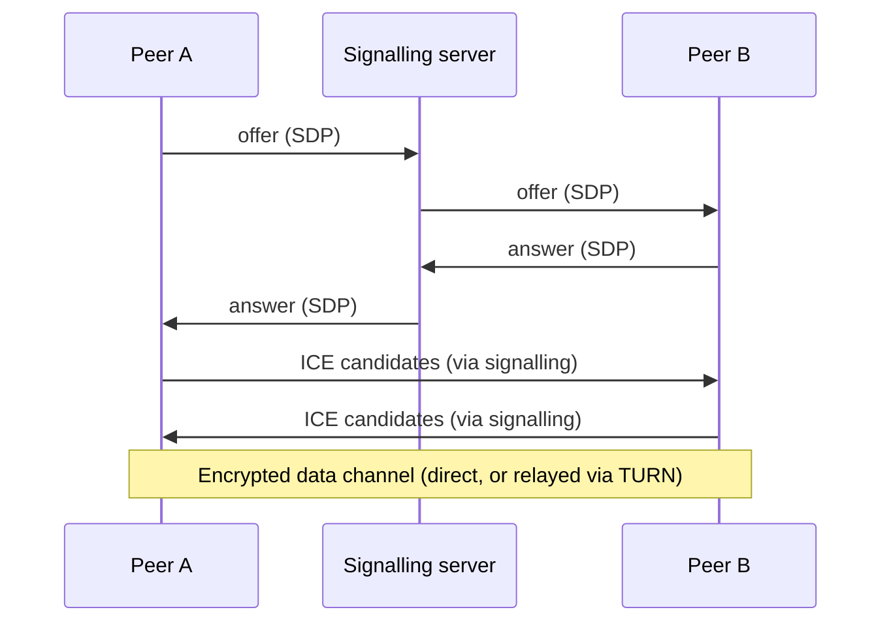
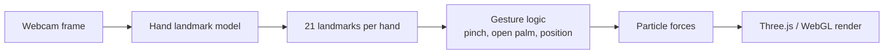

<!--
  ======================================================================
  MILEN SEBASTIAN · GITHUB PROFILE README
  Repository: github.com/milensebastian/milensebastian
  ======================================================================

  DESIGN TOKENS (shared by every asset)
    background      #080B12      card            #111824
    secondary bg    #101B30      elevated        #151E2D
    primary blue    #70AFFF      secondary blue  #4D8DFF
    highlight blue  #A8D0FF      border          #26364D
    text            #EAF2FF      text (soft)     #A6B2C5
    text (muted)    #77869D

  LOCAL ANIMATED SVGs (repository root) · SMIL animation only: no JS, no CSS
    hero.svg               header: drifting grid, network, scan beam, name
    divider.svg            standard divider: signal rail, pulse, 5 nodes
    divider-section.svg    alternate divider: centre node, rings, packets
    focus-map.svg          MILEN at the centre of five focus areas
    network-animation.svg  reusable mesh illustration (used in notes)
    footer.svg             waves, particles, scan beam, closing line

  MOTION SYSTEM (why the assets feel connected)
    - one 8 s master cycle; 4 s and 2 s loops divide it evenly
    - the scan beam sweeps for 75 % of the cycle, then rests
    - hero, footer and dividers reuse the same beam / pulse rhythm
    - the same motif everywhere: grid, node, travelling signal packet
    - every static state is readable even if animation is not supported

  EXTERNAL SERVICES
    readme-typing-svg.demolab.com   rotating tagline (JetBrains Mono)
    img.shields.io                  social + demo badges
    skillicons.dev                  icon strips
    github-readme-stats             exactly two cards: stats + languages
    Platane/snk                     contribution snake, produced by
                                    .github/workflows/snake.yml and
                                    published to the `output` branch

  RULES THIS FILE FOLLOWS
    - no JavaScript, no custom CSS, no iframes
    - every image has alt text
    - projects live in the pinned repositories, not duplicated here
    - no invented metrics, no proficiency percentages
-->

<div align="center">



<a href="https://github.com/milensebastian">
  
</a>

<sub>Cybersecurity undergraduate · Software developer · Experimental engineer</sub>

<br/><br/>

[](https://www.linkedin.com/in/milensebastian/)
[](https://github.com/milensebastian)


<sub><b>▸ LIVE DEMOS</b></sub>

<a href="https://stegovault-two.vercel.app/"></a>
<a href="https://aethiria-woad.vercel.app/"></a>
<a href="https://forge-p2p.vercel.app/"></a>
<a href="https://milen.vercel.app/"></a>


</div>

## `~/whoami`

```bash
milen@sjcet:~$ whoami
milen — B.Tech Cyber Security undergraduate @ SJCET Palai

milen@sjcet:~$ cat location.txt
Kerala, India

milen@sjcet:~$ cat interests.txt
▸ cybersecurity          ▸ cryptography
▸ software engineering   ▸ distributed systems
▸ computer vision        ▸ networking

milen@sjcet:~$ cat philosophy.txt
Understand. Build. Experiment. Improve.

milen@sjcet:~$ status
● turning ideas into working software
```

I like knowing what is happening underneath. How a cipher actually protects a byte. How two browsers find each other and talk without anyone relaying every message. How a camera frame turns into a hand position, and a hand position into a gesture. How a messy piece of software gets cleaner when you look at it honestly.

My usual loop is simple: read how it works, build the smallest version that runs, change one thing and see what breaks, then fix it properly. Security is the lens I look through, and software is how I test whether I understood anything.

I'm still a student and I'm still learning. I'd rather show what I built than claim what I know. The projects are pinned just below this README.

<div align="center">

</div>

## `~/focus`

<div align="center">

</div>

<br/>

| | Area | Exploring |
|:-:|:--|:--|
| `01` | **Cybersecurity** | Web security, security fundamentals, how attacks and defences work |
| `02` | **Cryptography** | Authenticated encryption, key derivation, how real mistakes get exploited |
| `03` | **Software Engineering** | Practical applications, cleaner architecture |
| `04` | **Distributed Systems** | Networking, peer-to-peer communication, collaborative state |
| `05` | **Computer Vision** | Gesture recognition, interactive visual experiences |
| `06` | **CS Foundations** | Problem solving, data structures, algorithms. This one sits underneath all the others |

<div align="center">

</div>

## `~/stack`

<div align="center">

| Category | Technologies |
|:--|:--|
| **Languages** | <br/><sub>C · Python · JavaScript · TypeScript</sub> |
| **Development** | <br/><sub>React · Node.js · Express · MongoDB · Three.js · Git</sub> |
| **Security & systems** | <br/>   |

</div>

<sub>Everything listed is something I have actually used. I'm still learning all of it, so no bars, percentages, or expert claims.</sub>

<div align="center">

</div>

## `~/notes`

Short technical notes on the ideas behind the things I build. Open whichever interests you.

<details>
<summary><b>01 · Cryptography notes: what AES-256-GCM and PBKDF2 actually do</b></summary>

<br/>

**AES-256-GCM** is *authenticated encryption*. One operation gives you two guarantees:

| Guarantee | Meaning | How |
|:--|:--|:--|
| Confidentiality | Without the key, the ciphertext reveals nothing useful | AES in counter mode |
| Integrity + authenticity | Any change to the ciphertext, nonce, or associated data is detected | A 128-bit authentication tag |

Things that matter more than the algorithm name:

- The **nonce must never repeat** under the same key. Reusing one with GCM breaks both secrecy and authenticity.
- The **tag must be verified before** any plaintext is used. A failed tag means the data is rejected, full stop.
- **Associated data (AAD)** can bind context (a version byte, a header) to the ciphertext without encrypting it.
- Encryption alone is not enough. Unauthenticated encryption can be modified without the receiver noticing.

**PBKDF2** turns a human password into a key suitable for AES:

- It repeatedly applies an HMAC with a random **salt**, so identical passwords produce different keys.
- The **iteration count** is the cost knob. More iterations means slower guessing for an attacker and slower unlocking for you.
- PBKDF2 is CPU-bound only. Newer designs (scrypt, Argon2id) are also memory-hard, which resists GPU cracking better.
- A strong key derivation does not rescue a weak password. It only makes guessing more expensive.

A generic construction (illustrative pseudocode, not taken from any particular project):

```text
salt        ← random(16 bytes)
key         ← PBKDF2-HMAC-SHA256(password, salt, iterations, 32 bytes)
nonce       ← random(12 bytes)
ct ‖ tag    ← AES-256-GCM-Encrypt(key, nonce, plaintext, aad = version)
payload     ← version ‖ salt ‖ nonce ‖ ct ‖ tag
```

Decryption reverses it: parse the payload, re-derive the key from the password and salt, verify the tag, and only then release the plaintext.

Common mistakes worth remembering:

| Mistake | Why it hurts |
|:--|:--|
| Hard-coded or reused nonce | Destroys GCM's guarantees |
| Low iteration count | Makes offline guessing cheap |
| Fixed salt | Enables precomputed attacks across users |
| Ignoring tag failure | Accepts tampered data |
| Rolling your own mode | Subtle bugs that nobody catches |

</details>

<details>
<summary><b>02 · Steganography and steganalysis notes</b></summary>

<br/>

**Steganography hides that a message exists. Encryption hides what the message says.** They solve different problems, and combining them is common: encrypt first, then hide.

**LSB (least significant bit) embedding**

- Each colour channel of a pixel is a byte. Flipping the lowest bit changes the value by at most 1, which is invisible to the eye.
- Capacity is roughly `width × height × channels` bits at one bit per channel, so a payload needs a big enough cover image.
- It needs a **lossless** format such as PNG. Lossy recompression (JPEG, many chat apps) rewrites pixel values and destroys the payload.
- A ciphertext looks like random bits. Random bits written into the LSB plane make that plane look *more* random than a natural photo's, and that is exactly what detectors look for.

**Steganalysis: how detection works**

| Technique | Idea |
|:--|:--|
| Histogram analysis | Embedding tends to equalise the counts of value pairs (2k, 2k+1) |
| Chi-square attack | Statistically tests whether those pairs are suspiciously balanced |
| RS analysis | Measures how flipping LSBs changes local smoothness of the image |
| Visual / bit-plane inspection | Looks at the LSB plane directly for structure or noise |

Lower embedding rates are harder to detect, so a short message in a big image is far safer than a large payload in a small one.

**Zero-width text hiding**

Some Unicode characters have no visible width: U+200B (zero-width space), U+200C (zero-width non-joiner), U+200D (zero-width joiner) and U+FEFF. Mapping bits onto a sequence of them hides data inside ordinary-looking text.

- It survives copy and paste in many places.
- It is trivially removed by anything that sanitises or normalises text.
- It is obvious to anyone who inspects the raw code points.

The honest summary: steganography is a fun and instructive way to learn about data representation, but it is **obscurity, not security**. The encryption layer is what actually protects the content.

</details>

<details>
<summary><b>03 · Networking notes: WebRTC, signalling, STUN and TURN</b></summary>

<br/>

"Peer-to-peer" does not mean "no servers". Browsers can send data directly to each other over WebRTC, but they first need help finding and reaching one another.

<div align="center">

</div>



| Piece | Role |
|:--|:--|
| **Signalling** | Not part of WebRTC itself. Peers swap session descriptions (SDP) and candidates through *some* channel, usually a small server |
| **ICE** | Gathers possible network routes and tests them to find one that works |
| **STUN** | Lets a peer learn its public address as seen from the internet |
| **TURN** | A relay of last resort when no direct route exists (strict NATs, firewalls) |
| **DTLS / SRTP** | Encrypt the connection, so even relayed media or data is protected in transit |
| **Data channels** | Message-based pipes for arbitrary data, built on SCTP over DTLS |

So the accurate claim for a WebRTC app is: *application data travels between peers, but signalling, and sometimes relaying, still needs servers.*

**Shared state with Yjs**

Yjs implements **CRDTs** (conflict-free replicated data types). Every peer edits its own local copy; updates are small, mergeable messages. Because the merge rules are deterministic and commutative, peers that receive the same set of updates, in any order, converge to the same document. That makes it a good fit for collaborative text editing without a central authority deciding who "wins".

Questions I like to keep asking about systems like this:

- What happens when a peer goes offline and comes back with a pile of edits?
- Who can read the data in transit, and who can write to the shared state?
- What does the signalling server learn about the participants?
- What breaks when two peers sit behind strict NATs?

</details>

<details>
<summary><b>04 · Computer vision notes: from camera frame to gesture</b></summary>

<br/>



**What the model gives you.** MediaPipe's hand tracking detects a palm, then predicts **21 landmarks** per hand (wrist, knuckles, fingertips). Coordinates arrive normalised to the image (0 to 1), plus a relative depth value. There is no "gesture" in that output, only points.

**Gestures are geometry.** You build them on top of the landmarks:

| Gesture | Simple rule |
|:--|:--|
| Pinch | Distance between thumb tip (landmark 4) and index tip (landmark 8) below a threshold |
| Open palm | Fingertips farther from the wrist than their knuckles |
| Pointer | Index fingertip position mapped to screen or world space |

An illustrative snippet (generic, not copied from any repository):

```javascript
// landmarks: array of 21 {x, y, z}, normalised 0..1
function pinchStrength(landmarks) {
  const thumbTip = landmarks[4];
  const indexTip = landmarks[8];
  const d = Math.hypot(thumbTip.x - indexTip.x, thumbTip.y - indexTip.y);
  // closer than ~0.03 → strong pinch, farther than ~0.1 → none
  return 1 - Math.min(Math.max((d - 0.03) / 0.07, 0), 1);
}
```

**Making it feel good.**

- Raw landmarks jitter, so smooth them (for example with an exponential moving average) before using them.
- Choose thresholds with some hysteresis so a gesture doesn't flicker on and off at the boundary.
- Camera coordinates are mirrored relative to what a user expects, so flip the x axis.
- For thousands of particles, update typed arrays and let the GPU draw them. Do not create thousands of separate objects.

**Privacy note.** Everything above can run in the browser, so camera frames never need to leave the device. That is a good default for any camera-based project.

</details>

<details>
<summary><b>05 · Engineering principles: what the philosophy means in practice</b></summary>

<br/>

| | Principle | In practice |
|:-:|:--|:--|
| 🔍 | **Understand** | Read the spec, the RFC, or the source before the tutorial. Draw the system before touching it |
| 🛠️ | **Build** | Ship the smallest thing that runs end to end, then deepen it |
| 🧪 | **Experiment** | Change one variable at a time. Break it on purpose. Write down what happened |
| 📈 | **Improve** | Refactor with a reason, measure when it matters, delete what isn't needed |

Habits I'm trying to keep:

- Prefer boring, well-tested building blocks over clever custom ones, especially in security.
- Make the failure case explicit: what happens when the network drops, the input is malformed, or the key is wrong?
- Name things for the person reading the code next, who is often me in three months.
- Keep a short note of what I learned from each project, including what I got wrong.
- Describe a project by what it actually does. Overclaiming helps nobody.

</details>

<details>
<summary><b>06 · Web security notes: how I read the OWASP Top Ten</b></summary>

<br/>

The OWASP Top Ten (2021 edition) is a list of the most common web application risk categories. I use it as a checklist of *questions to ask*, not a list to memorise.

| Category | The question I ask |
|:--|:--|
| **Broken access control** | Can user A reach user B's data by changing an ID, a URL, or a role? |
| **Cryptographic failures** | Is sensitive data encrypted in transit and at rest, with sound algorithms and key handling? |
| **Injection** | Does any user input end up inside a query, command, or template without being separated from the code? |
| **Insecure design** | Was abuse considered before the feature was built, or only after? |
| **Security misconfiguration** | Are defaults, debug modes, headers, and permissions deliberately set? |
| **Vulnerable and outdated components** | Do I know what my dependencies are, and are they maintained? |
| **Identification and authentication failures** | Are passwords, sessions, and recovery flows handled with care? |
| **Software and data integrity failures** | Can an update, a package, or a pipeline step be tampered with unnoticed? |
| **Logging and monitoring failures** | Would I notice an attack, and would I have the evidence afterwards? |
| **Server-side request forgery** | Can a user make my server fetch something it should never reach? |

Defensive habits that apply to almost everything:

- Validate input on the server. Client-side checks are a convenience, not a control.
- Use parameterised queries or an ORM's safe APIs rather than building queries from strings.
- Enforce authorisation on every request, not only in the UI.
- Escape output for the context it lands in (HTML, attribute, URL, JavaScript).
- Keep secrets out of source control and out of client-side bundles.
- Send security-relevant headers deliberately (for example a Content-Security-Policy) instead of leaving defaults.
- Keep dependencies few, pinned, and updated.

A reminder to myself: a vulnerability is a weakness, an exploit is a way to use it, and risk depends on both the likelihood and the impact. Not every finding is critical.

</details>

<details>
<summary><b>07 · Threat modelling notes: questions before code</b></summary>

<br/>

Threat modelling is thinking like a defender *and* an attacker before the design hardens. The simplest framework I use is **STRIDE**, which gives each threat a name and the security property it violates.

| Threat | Violates | Typical question |
|:--|:--|:--|
| **S**poofing | Authenticity | Can someone pretend to be another user or service? |
| **T**ampering | Integrity | Can data be modified in storage or in transit without detection? |
| **R**epudiation | Non-repudiation | Can an actor deny what they did, and could I prove otherwise? |
| **I**nformation disclosure | Confidentiality | Where could data leak: logs, errors, backups, URLs? |
| **D**enial of service | Availability | What is the cheapest way to make this stop working? |
| **E**levation of privilege | Authorisation | Can a low-privilege actor do something reserved for a higher one? |

The four questions that keep me honest:

1. **What are we building?** Draw the components, the data flows, and the trust boundaries.
2. **What can go wrong?** Walk each flow and boundary through STRIDE.
3. **What are we going to do about it?** Mitigate, accept, transfer, or remove the feature.
4. **Did we do a good enough job?** Re-check after changes.

Trust boundaries are where most problems hide: browser to server, server to database, service to service, user input to anything that interprets it.

Illustrative example (generic, for practice): for a peer-to-peer collaborative editor, a quick pass might ask

- *Spoofing*: how does a peer prove who it is before joining a room?
- *Tampering*: can a malicious peer send updates that corrupt the shared document?
- *Information disclosure*: what does the signalling server learn about participants?
- *Denial of service*: can one peer flood others with updates?
- *Elevation of privilege*: can a read-only participant send edits?

Writing these down, even briefly, changes what gets built.

</details>

<details>
<summary><b>08 · Linux and command-line notes</b></summary>

<br/>

Commands I reach for, and what they tell me:

| Command | What it answers |
|:--|:--|
| `ip a` | Which network interfaces and addresses does this machine have? |
| `ss -tulpn` | Which programs are listening on which ports? |
| `journalctl -u <service>` | What has this service been logging? |
| `grep -rn "pattern" .` | Where in this tree does this text appear? |
| `find . -type f -perm -o+w` | Which files are writable by everyone? |
| `ls -l` | Who owns this file, and who may read, write, or execute it? |
| `ps aux` | What is running, and as whom? |
| `tcpdump -i any port 53` | What DNS traffic is this machine producing right now? |

**File permissions in one paragraph.** Each file has an owner, a group, and "others". Each of those gets read (4), write (2), and execute (1) bits that add up to one digit. So `600` means owner read/write and nobody else can touch it, which is right for a private key. `644` is owner read/write and everyone else read-only. `777` means anyone can do anything, and it is almost never the right answer.

```bash
# a private key should be readable only by its owner
chmod 600 ~/.ssh/id_ed25519

# see what is listening, and under which process
ss -tulpn

# scan a host that I own (never scan systems without permission)
nmap -sV 192.168.1.10
```

Habits:

- Prefer the principle of least privilege: run things as a normal user, use `sudo` for the single command that needs it.
- Read a script before piping it to a shell.
- Keep a notes file of commands that solved real problems, with a line about *why* they worked.
- Use `man <command>` and `--help` before searching the web. The documentation is usually right there.
- Only use scanning tools like Nmap against my own machines or lab environments.

</details>

<details>
<summary><b>09 · Reading a packet capture: a Wireshark workflow</b></summary>

<br/>

Wireshark shows what actually crossed the wire. It's one of the best ways to turn networking theory into something concrete.

**A workflow I like**

1. Capture on one interface, for a short and specific action (load one page, run one command).
2. Start broad: *Statistics → Conversations* shows who talked to whom, and how much.
3. Narrow with a display filter.
4. Follow a stream (*right-click → Follow → TCP Stream*) to read one conversation end to end.
5. Write down what I expected before comparing it with what I see.

**Display filters worth knowing**

| Filter | Shows |
|:--|:--|
| `dns` | Name lookups and answers |
| `ip.addr == 192.168.1.10` | Everything to or from one address |
| `tcp.port == 443` | Traffic on one TCP port |
| `tcp.flags.syn == 1 && tcp.flags.ack == 0` | New connection attempts (first step of the handshake) |
| `tls.handshake.type == 1` | TLS ClientHello messages |
| `http.request` | Plain HTTP requests |
| `!(arp or icmp or dns)` | Everything *except* background noise |

**Things a capture teaches**

- The TCP three-way handshake (SYN, SYN-ACK, ACK) is visible packet by packet.
- Plain HTTP is readable by anyone on the path, which is the clearest argument for HTTPS.
- With TLS, the payload is encrypted, but metadata such as destination addresses and timing is not, and a server name may be visible in the handshake.
- DNS is a surprisingly rich source of information about what a device is doing.
- Retransmissions and resets are the visible symptoms of network problems.

**Ground rule:** capture only traffic from networks and devices I own or have explicit permission to analyse.

</details>

<details>
<summary><b>10 · Git and project hygiene</b></summary>

<br/>

Small habits that make projects easier to maintain, and safer to publish.

```bash
# see what changed, in small readable pieces
git status
git diff

# stage deliberately instead of "add everything"
git add -p

# write the message for the person reading the history later
git commit -m "Verify auth tag before returning decrypted data"

# keep the history readable
git log --oneline --graph --decorate -15
```

| Habit | Why |
|:--|:--|
| One logical change per commit | History becomes a readable story and bugs are easier to bisect |
| Commit messages in the imperative ("Add", "Fix", "Remove") | Consistent and easy to scan |
| Short-lived feature branches | Small, reviewable changes |
| A real `.gitignore` from the first commit | Keeps build output and local files out |
| A README that says what the project does and how to run it | The first thing every visitor reads |

**Secrets, the one that matters most**

- Never commit API keys, tokens, private keys, or `.env` files.
- If a secret is ever committed, treat it as compromised: **rotate it first**, then clean the history. Deleting the file in a later commit does not remove it from history.
- Keep configuration in environment variables, with a committed `.env.example` that lists names but no values.
- Turn on the repository's secret scanning and dependency alerts where available.

**Before publishing a project**

- Remove dead code and debug logging.
- Check that the README matches what the project actually does today.
- Describe limitations honestly, including what the project does *not* protect against.
- Add a licence so others know what they may do with it.

</details>

<details>
<summary><b>11 · Glossary: security terms I keep mixing up</b></summary>

<br/>

Clear vocabulary prevents clear mistakes. These are the pairs I make myself double-check.

| Terms | The difference |
|:--|:--|
| **Encoding vs encryption vs hashing** | Encoding (Base64) is reversible by anyone and offers no secrecy. Encryption is reversible only with a key. Hashing is one-way |
| **Authentication vs authorisation** | Authentication asks *who are you?* Authorisation asks *what may you do?* |
| **Vulnerability vs exploit vs threat vs risk** | A weakness, a way to use it, someone who might, and the combined likelihood and impact |
| **Symmetric vs asymmetric** | One shared key (fast, e.g. AES) versus a public/private key pair (e.g. RSA, elliptic curves) |
| **Salt vs nonce vs IV** | A salt randomises password hashing or key derivation. A nonce is a number used once per key. An IV is the initial value for a cipher mode. All must be generated correctly |
| **MAC vs digital signature** | A MAC proves integrity with a shared key. A signature proves integrity and origin with a private key |
| **Hash vs password hash** | General hashes (SHA-256) are fast by design. Password hashing must be deliberately slow and salted |
| **Steganography vs cryptography** | Hiding that a message exists versus hiding what it says |
| **Obfuscation vs security** | Obscurity can delay an attacker, but it isn't a control by itself |
| **Black-box vs white-box testing** | Testing with no knowledge of the internals versus with full access to design and code |

**The CIA triad**

| Property | Goal | Example control |
|:--|:--|:--|
| **Confidentiality** | Only the right people can read it | Encryption, access control |
| **Integrity** | It hasn't been changed unexpectedly | Hashes, MACs, signatures, authenticated encryption |
| **Availability** | It works when it is needed | Redundancy, backups, rate limiting |

Defence in depth means no single control is trusted to do everything. If one layer fails, another still stands.

</details>

<details>
<summary><b>12 · Learning backlog: what I want to get through next</b></summary>

<br/>

This is a to-do list, not a list of achievements.

**Security**

- [ ] Work through web security labs (injection, access control, authentication) on a practice platform
- [ ] Solve cryptography challenges to understand how real mistakes get exploited
- [ ] Capture and read traffic from my *own* network in Wireshark, end to end
- [ ] Learn how TLS handshakes work by reading them, not just using them

**Software**

- [ ] Write a small cipher or hash implementation in C purely to learn (never for production)
- [ ] Add automated tests to my projects and keep them running
- [ ] Practise reading unfamiliar codebases and writing down how they fit together

**Systems**

- [ ] Read the STUN, TURN and ICE specifications properly
- [ ] Build a tiny signalling server and understand every message it relays
- [ ] Experiment with CRDT behaviour under offline edits

**Foundations**

- [ ] Steady practice on data structures and algorithms
- [ ] Revisit operating-system and networking fundamentals

</details>

<details>
<summary><b>13 · Responsible security practice</b></summary>

<br/>

Security knowledge is only useful when it is used responsibly. My ground rules:

- I test systems that I **own**, or where I have **explicit permission**.
- I practise on purpose-built labs and my own setups, not on other people's services.
- If I ever find a real vulnerability in someone else's software, I report it privately and responsibly instead of publicising it.
- I don't publish working exploits for unpatched issues.
- I treat other people's data as off limits, even when it is technically reachable.

</details>

<details>
<summary><b>14 · References I keep open</b></summary>

<br/>

*These are the primary sources I like to go back to. Check each link before relying on it.*

| Topic | Reference |
|:--|:--|
| GCM mode | [NIST SP 800-38D](https://csrc.nist.gov/pubs/sp/800/38/d/final) |
| PBKDF2 | [RFC 8018 (PKCS #5 v2.1)](https://www.rfc-editor.org/rfc/rfc8018) |
| ICE | [RFC 8445](https://www.rfc-editor.org/rfc/rfc8445) |
| STUN | [RFC 8489](https://www.rfc-editor.org/rfc/rfc8489) |
| TURN | [RFC 8656](https://www.rfc-editor.org/rfc/rfc8656) |
| WebRTC | [MDN: WebRTC API](https://developer.mozilla.org/en-US/docs/Web/API/WebRTC_API) |
| CRDTs / Yjs | [Yjs documentation](https://docs.yjs.dev/) |
| 3D graphics | [Three.js documentation](https://threejs.org/docs/) |
| Web security | [OWASP Top Ten](https://owasp.org/www-project-top-ten/) |
| Practice labs | [PortSwigger Web Security Academy](https://portswigger.net/web-security) |
| Crypto practice | [Cryptopals](https://cryptopals.com/) |

</details>

<details>
<summary><b>15 · Accessibility and text-only summary</b></summary>

<br/>

This profile uses images from external services (banner, typing tagline, badges, icons, stats cards). If any of them fail to load, here is everything that matters in plain text.

- **Name:** Milen Sebastian
- **Role:** B.Tech Cyber Security undergraduate, St. Joseph's College of Engineering and Technology, Palai (SJCET)
- **Location:** Kerala, India
- **Positioning:** Cybersecurity undergraduate, software developer, experimental engineer
- **Interests:** Cybersecurity, cryptography, software engineering, distributed systems, computer vision, networking, web technologies
- **Languages:** C, Python, JavaScript, TypeScript
- **Development:** React, Node.js, Express, MongoDB, Three.js, Git
- **Security and systems:** Wireshark, Burp Suite, Nmap, Linux
- **Philosophy:** Understand. Build. Experiment. Improve.
- **StegoVault demo:** https://stegovault-two.vercel.app/
- **AETHIRIA demo:** https://aethiria-woad.vercel.app/
- **FORGE demo:** https://forge-p2p.vercel.app/
- **Portfolio:** https://milen.vercel.app/
- **LinkedIn:** https://www.linkedin.com/in/milensebastian/
- **GitHub:** https://github.com/milensebastian

Motion: the animated graphics loop slowly and are purely decorative. Nothing on this page is communicated only through movement.

Design choices for readability: high-contrast text on a dark background, meaningful alt text on every image, no information that exists only inside an image, and collapsible sections for secondary material.

</details>

<details>
<summary><b>16 · How this profile is built</b></summary>

<br/>

| Service | Used for | If it is down |
|:--|:--|:--|
| [Readme Typing SVG](https://github.com/DenverCoder1/readme-typing-svg) | Rotating tagline | A static tagline line sits below it |
| [Shields.io](https://shields.io/) | Social and demo badges | Alt text names each link, and plain links are listed in note 15 |
| [skillicons.dev](https://skillicons.dev/) | Language and tool icons | Names are printed under the icons |
| [GitHub Readme Stats](https://github.com/anuraghazra/github-readme-stats) | Stats and top-languages cards | The rest of the page is unaffected |
| [Platane/snk](https://github.com/Platane/snk) | Contribution snake | Appears only after the workflow has run |
| Six local SVGs in the repository root | Hero, two dividers, focus map, network illustration, footer | Hosted in this repository, no third party. Static layout stays readable if animation is unsupported |

Motion design: one shared 8-second cycle drives the scan beam, signal pulses and node highlights across the hero, dividers and footer, so the page moves as one system. The animations are SVG-native (SMIL), with no scripts and no CSS.

Principles: no scripts, no custom CSS, no iframes, no fake live widgets. Every image carries alt text, and nothing important is communicated only by an animation.

</details>

<div align="center">

</div>

## `~/github`

<div align="center">


<br/><br/>

<!--
  The snake files below are created by .github/workflows/snake.yml and
  pushed to the `output` branch. Until that workflow has run once, these
  two images will not load.
-->
<picture>
  <source media="(prefers-color-scheme: dark)" srcset="https://raw.githubusercontent.com/milensebastian/milensebastian/output/github-snake-dark.svg" />
  <source media="(prefers-color-scheme: light)" srcset="https://raw.githubusercontent.com/milensebastian/milensebastian/output/github-snake.svg" />
  
</picture>

<sub>My full contribution calendar is shown natively by GitHub below the pinned repositories.</sub>

</div>

<div align="center">

</div>

## `~/connect`

Open to collaborating on security tooling, cryptography projects, distributed systems and experimental software. If you're building something interesting, I'd like to hear about it.

| Channel | Where |
|:--|:--|
| 🌐 Portfolio | [milen.vercel.app](https://milen.vercel.app/) |
| 💼 LinkedIn | [in/milensebastian](https://www.linkedin.com/in/milensebastian/) |
| 🐙 GitHub | [@milensebastian](https://github.com/milensebastian) |

<div align="center">



</div>
